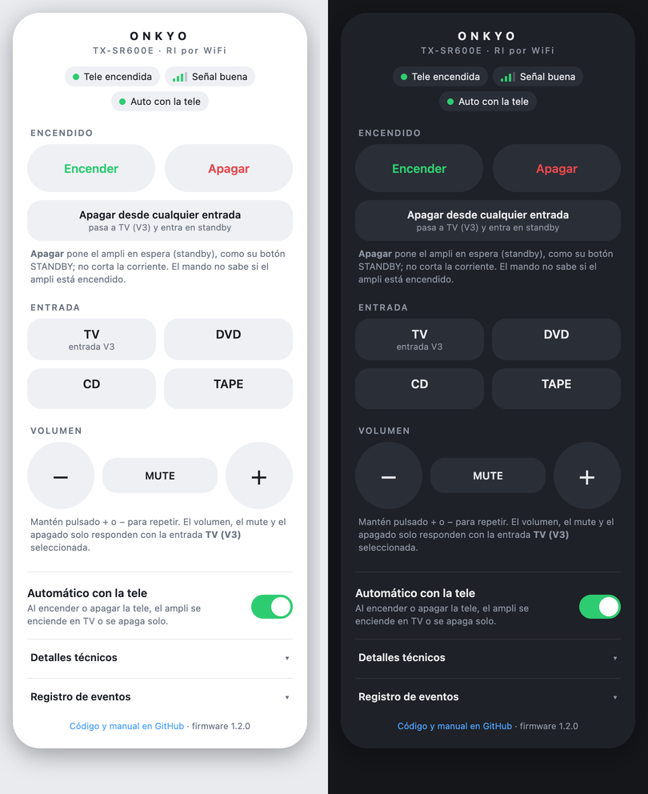

# onkyo-ri-wifi

*[Read in English](README.md)*

Lleva un receptor Onkyo antiguo a la era del WiFi con una placa ESP8266 de pocos euros.

- **Sigue a tu tele.** Al encender una Samsung (Tizen), el receptor se enciende y selecciona la entrada de la tele; al apagarla, pasa a standby.
- **Mando web para el móvil.** Encendido, entrada, volumen y mute desde cualquier navegador de tu red, en español o en inglés, en claro u oscuro.
- **Actualizaciones por WiFi (OTA).** Tras la primera carga por USB no vuelves a necesitar el cable.

Habla **Onkyo RI** (Remote Interactive), el conector de 3,5 mm *REMOTE CONTROL* de la parte trasera de muchos Onkyo, así que no hay que apuntar ningún LED infrarrojo.

<p align="center"></p>

> **Probado en una sola instalación:** Onkyo TX-SR600E, Samsung QE75Q70R, NodeMCU V3 (CH340), macOS 12, `arduino-cli` 1.5.1 y núcleo ESP8266 3.1.2. Otros modelos Onkyo usan otros códigos (ver [Adaptarlo a tu equipo](#adaptarlo-a-tu-equipo)). Proyecto no oficial, sin relación con Onkyo ni Samsung; conectas el hardware a tu receptor bajo tu responsabilidad.

## Qué necesitas

- Un NodeMCU V3 (sirve cualquier placa ESP8266 con un GPIO libre) y un cable USB **con líneas de datos**
- Un cable con jack de 3,5 mm (o uno que puedas cortar y recablear)
- Un receptor Onkyo con conector **RI REMOTE CONTROL**
- Una tele Samsung que responda a la API Tizen en el puerto 8001 (probado en un QLED de 2019)
- Un cargador USB para alimentar la placa

## Cableado

El conector RI es un jack mono de 3,5 mm: **punta = datos, cuerpo = masa**.

<p align="center"></p>

A quien escribe también le funcionó un jack estéreo (TRS): el anillo no se usa. El conector del receptor es así:

<p align="center"></p>

El ESP8266 saca 3,3 V y es suficiente para el TX-SR600E.

**Configuración del receptor.** En el TX-SR600E, RI solo controla el apagado, el volumen y el mute con la entrada **V3** seleccionada. Por eso, en el menú de configuración del receptor, asigna la **entrada óptica de la tele a V3** (mira el manual para el menú exacto).

## Instalación

```bash
# 1. Herramientas
arduino-cli config add board_manager.additional_urls https://arduino.esp8266.com/stable/package_esp8266com_index.json
arduino-cli core update-index
arduino-cli core install esp8266:esp8266

# 2. Ajustes: copia el ejemplo y rellénalo
cd firmware/onkyo-ri-wifi
cp config.example.h config.h     # nombre y clave del WiFi, IP de la tele, clave de admin

# 3. Primera carga, por USB (tu puerto sale con: arduino-cli board list)
arduino-cli compile --fqbn esp8266:esp8266:nodemcuv2 .
arduino-cli upload  --fqbn esp8266:esp8266:nodemcuv2 -p <puerto> .
```

Dale a la tele una dirección fija: **reserva su IP en el DHCP de tu router** para que no cambie nunca. También vale el Arduino IDE: instala el paquete de placas *esp8266*, abre `onkyo-ri-wifi.ino` y elige *NodeMCU 1.0 (ESP-12E Module)*.

### Cargar por USB

- **Usa un cable de datos.** Muchos cables micro-USB solo cargan. Si no aparece ningún puerto serie al conectar la placa, prueba con otro cable.
- **Driver.** El NodeMCU V3 usa un chip USB CH340/CH341 (otras placas llevan un CP2102). En macOS 12 el puerto apareció sin instalar nada; si en tu equipo no aparece, instala el driver del fabricante de tu chip. Windows suele encontrarlo solo. En Linux ya viene incluido, y tu usuario debe estar en el grupo `dialout`.
- **Nombre del puerto.** `/dev/cu.usbserial-XXXX` en macOS, `/dev/ttyUSB0` en Linux, `COM3` (o similar) en Windows. `arduino-cli board list` lo muestra, y el número puede cambiar si usas otro puerto USB.
- **Monitor serie** a 115200 baudios: muestra el registro de arranque y la dirección WiFi.
- Si una carga falla, mantén pulsado el botón FLASH de la placa, toca RST, suelta FLASH y reinténtalo.

### Actualizar por WiFi

```bash
arduino-cli upload -p <ip-de-la-placa> --protocol network \
  --fqbn esp8266:esp8266:nodemcuv2 \
  --upload-field password=<tu clave de admin> .
```

Mantén OTA en todas las versiones que cargues; sin él necesitas el cable otra vez. No desenchufes la placa durante un minuto después de actualizar. En macOS con el cortafuegos activado, la placa debe poder conectarse de vuelta a tu ordenador: si la subida termina con `No response from device`, permite las conexiones entrantes del `python3` incluido en `~/Library/Arduino15/packages/esp8266/tools/python3/`.

## Uso

Abre `http://<ip-de-la-placa>/` en el navegador (usuario `admin`). Mantener pulsado `+` o `−` repite el paso de volumen. Un panel de *Detalles técnicos* muestra la señal, las direcciones y el tiempo encendida, y otro de *Registro de eventos* los últimos 60 eventos. El LED azul de la placa refleja el estado de la tele (encendido = tele encendida).

Las mismas acciones están disponibles como una pequeña API:

| Petición | Acción |
|---|---|
| `/cmd?c=on` / `off` | Encender (entrada TV) / apagar |
| `/cmd?c=off_any_input` | Cambia primero a la entrada TV y luego apaga |
| `/cmd?c=in_tv`, `in_dvd`, `in_cd`, `in_tape` | Seleccionar entrada |
| `/cmd?c=vol_up`, `vol_down`, `mute_toggle` | Volumen y mute |
| `/auto?v=0` o `1` | Seguir a la tele desactivado (modo manual) / activado |
| `/status`, `/log`, `/reboot` | Estado en JSON, registro de eventos, reiniciar la placa |
| `/raw?code=1A0` | Envía un código RI en bruto (solo `0x001`–`0x1FF`) |

### Cómo funciona la sincronización con la tele

Cada 2,5 s la placa pregunta a la tele (`http://<tele>:8001/api/v2/`) por su `PowerState`. Cuando cambia, envía el comando RI una sola vez. Dos medidas evitan bucles, por ejemplo si salta la protección del receptor: **solo actúa cuando cambia el estado de la tele** y espera **al menos 15 s** entre dos acciones. Nunca reenvía un comando por su cuenta.

Si el receptor está en otra entrada (por ejemplo escuchas música), apagar la tele **no** lo apaga: el receptor ignora el código de apagado si no está seleccionada la entrada de la tele. Desactiva el interruptor *Automático con la tele* para usar el receptor sin que la tele intervenga.

## Seguridad

- **No subas `config.h` a git.** Está en `.gitignore`; en el repositorio solo está `config.example.h`, con valores de ejemplo.
- `ADMIN_PASSWORD` protege la web (usuario `admin`) y las actualizaciones OTA. El registro avisa si dejas la clave por defecto `change-me`.
- La web usa HTTP normal con autenticación básica, así que **úsala solo en tu red doméstica y nunca la abras a internet.**
- Pon `WEB_AUTH = false` en `config.h` para quitar la clave de la página web si confías en tu red. OTA conserva su clave. Cualquiera en tu WiFi podría entonces cambiar el volumen, así que piénsalo antes.

## Códigos RI del TX-SR600E

| Código | Efecto |
|---|---|
| `0x020` / `0x070` / `0x120` / `0x1A0` | Selecciona CD / TAPE / DVD / V3 |
| `0x1AF` / `0x12F` | Encender + V3 / encender + DVD |
| `0x1AE` | Apagar (solo si está seleccionada V3) |
| `0x1A2` / `0x1A3` | Subir / bajar volumen (solo en V3) |
| `0x1A4` / `0x1A5` | Mute / quitar mute (solo en V3) |

Nada más de lo que probamos tuvo efecto, y **no se deben enviar nunca `0x420`–`0x43F`**: son códigos de prueba y servicio. La lista completa, lo que se probó y cómo, está en [docs/ri-codes.es.md](docs/ri-codes.es.md).

## Adaptarlo a tu equipo

- **Otro receptor Onkyo:** los códigos están en un solo bloque al principio de `onkyo-ri-wifi.ino`. Cámbialos por los de tu modelo. Los códigos varían mucho entre modelos; [docs/ri-codes.es.md](docs/ri-codes.es.md) explica cómo encontrar los tuyos enviando códigos desde `/raw` mientras miras la pantalla del receptor.
- **Otra tele:** sustituye `readTvState()`, que debe devolver 1 (encendida), 0 (apagada o en standby) o -1 (desconocido).
- **Otro pin:** cambia `PIN_RI_OUT`.

## Problemas habituales

| Síntoma | Prueba |
|---|---|
| No aparece puerto serie al conectar | Otro cable USB (con datos) y después el driver del chip |
| La web pide clave | Usuario `admin` y la clave de `config.h` (o pon `WEB_AUTH = false`) |
| Los comandos no hacen nada | Revisa el cableado, y que el receptor esté en V3 para apagar, volumen y mute |
| La placa no aparece en la red | Mira el monitor serie: muestra el estado del WiFi y su dirección |
| `No response from device` en OTA | Permite las conexiones entrantes del `python3` incluido (ver arriba) |

## Créditos

- Códigos RI y notas del protocolo: [docbender/Onkyo-RI](https://github.com/docbender/Onkyo-RI) (MIT).
- La tabla del TX-SR605 en [node-red-contrib-onkyo-ri](https://github.com/dajuly20/node-red-contrib-onkyo-ri) (MIT) coincide con nuestros resultados: por RI solo se pueden seleccionar CD, TAPE, DVD y GAME/TV (nuestra V3), y el volumen, el mute y el apagado solo funcionan con GAME/TV seleccionada.
- Los códigos del A-9010 que probamos salen de [victorjacobs/onkyo-mqtt](https://github.com/victorjacobs/onkyo-mqtt).

Aquí no se incluye código de esos proyectos, solo las listas de códigos y las notas del protocolo.

## Licencia

MIT. Ver [LICENSE](LICENSE).
