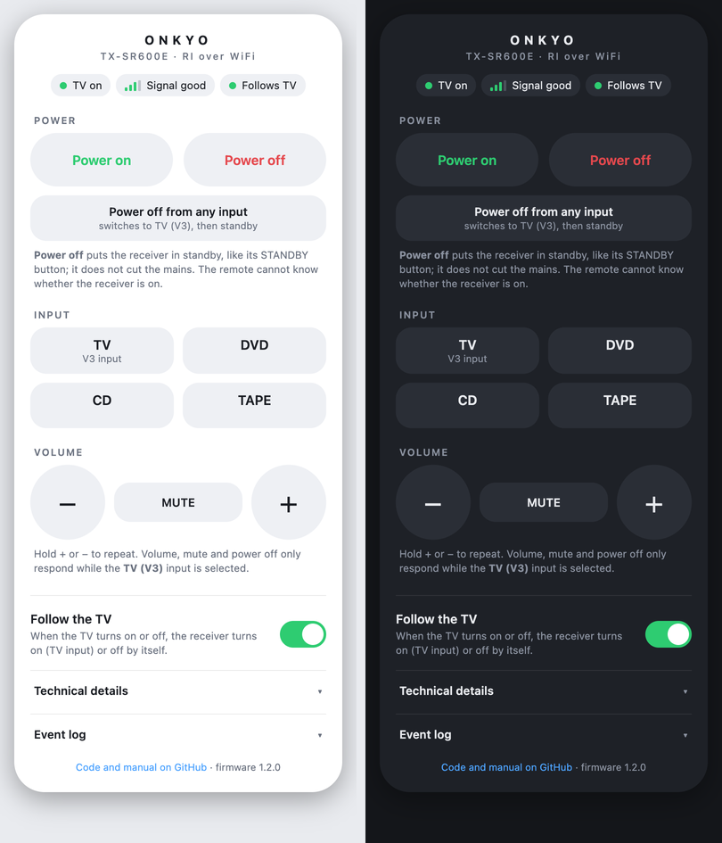
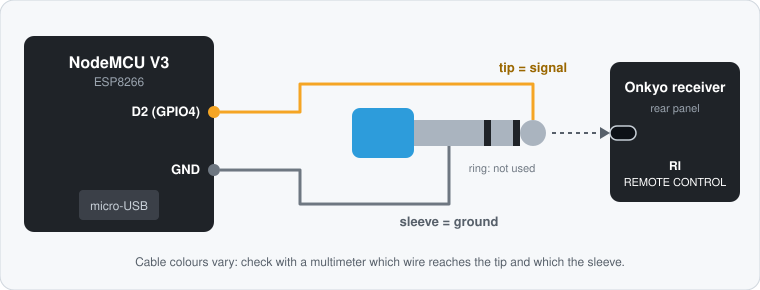
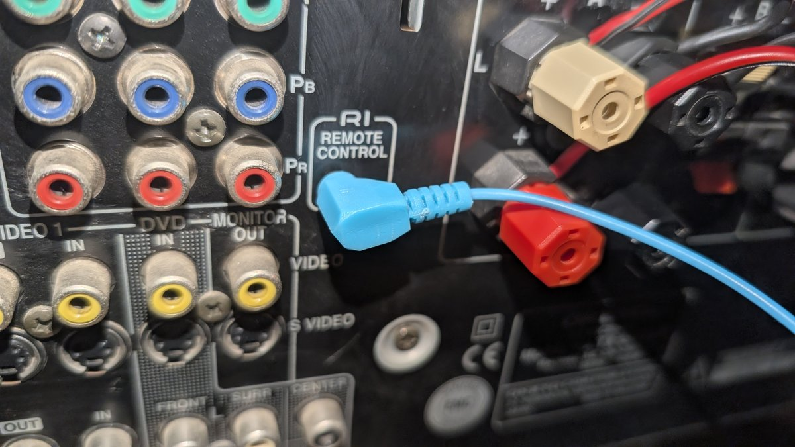

# onkyo-ri-wifi

*[Leer en español](README.es.md)*

Bring an older Onkyo receiver into the Wi-Fi era with a few-euro ESP8266 board.

- **Follows your TV.** When a Samsung (Tizen) TV turns on, the receiver turns on and selects the TV input; when the TV turns off, the receiver goes to standby.
- **Web remote for your phone.** Power, input, volume and mute from any browser on your network, in English or Spanish, light or dark.
- **Updates over Wi-Fi (OTA).** After the first USB flash you do not need the cable again.

It talks **Onkyo RI** (Remote Interactive), the wired 3.5 mm *REMOTE CONTROL* jack on the back of many Onkyo receivers, so there is no infrared LED to aim.

<p align="center"></p>

> **Tested on one setup:** Onkyo TX-SR600E, Samsung QE75Q70R, NodeMCU V3 (CH340), macOS 12, `arduino-cli` 1.5.1, ESP8266 core 3.1.2. Other Onkyo models use different codes (see [Adapting it](#adapting-it-to-your-setup)). Unofficial project, not affiliated with Onkyo or Samsung; you connect hardware to your receiver at your own risk.

## What you need

- A NodeMCU V3 (any ESP8266 board with a free GPIO works) and a USB cable **with data lines**
- A 3.5 mm plug cable (or one you can cut and rewire)
- An Onkyo receiver with an **RI REMOTE CONTROL** jack
- A Samsung TV that answers the Tizen API on port 8001 (tested on a 2019 QLED)
- A USB charger to power the board

## Wiring

The RI jack is a mono 3.5 mm socket: **tip = data, sleeve = ground**.

<p align="center"></p>

A stereo (TRS) plug also worked for the author: the ring is not used. The jack on the receiver looks like this:

<p align="center"></p>

The ESP8266 outputs 3.3 V, which is enough for the TX-SR600E.

**Receiver setup.** On the TX-SR600E, RI only controls power off, volume and mute while the **V3** input is selected. So in the receiver's setup menu, assign the TV's **optical input to V3** (check your manual for the exact menu).

## Install

```bash
# 1. Tools
arduino-cli config add board_manager.additional_urls https://arduino.esp8266.com/stable/package_esp8266com_index.json
arduino-cli core update-index
arduino-cli core install esp8266:esp8266

# 2. Settings: copy the example and fill it in
cd firmware/onkyo-ri-wifi
cp config.example.h config.h     # Wi-Fi name and password, TV IP, admin password

# 3. First flash, by USB (find your port with: arduino-cli board list)
arduino-cli compile --fqbn esp8266:esp8266:nodemcuv2 .
arduino-cli upload  --fqbn esp8266:esp8266:nodemcuv2 -p <port> .
```

Give the TV a fixed address: **reserve its IP in your router's DHCP settings** so it never changes. The Arduino IDE works too: install the *esp8266* board package, open `onkyo-ri-wifi.ino` and choose *NodeMCU 1.0 (ESP-12E Module)*.

### Flashing by USB

- **Use a data cable.** Many micro-USB cables only charge. If no serial port appears when you plug the board in, try another cable.
- **Driver.** The NodeMCU V3 uses a CH340/CH341 USB chip (other boards use a CP2102). On macOS 12 the port appeared without installing anything; if yours does not, install the vendor driver for your chip. Windows usually finds it by itself. On Linux it is built in, and your user must be in the `dialout` group.
- **Port name.** `/dev/cu.usbserial-XXXX` on macOS, `/dev/ttyUSB0` on Linux, `COM3` (or similar) on Windows. `arduino-cli board list` shows it, and the number can change if you use another USB port.
- **Serial monitor** at 115200 baud shows the boot log and the Wi-Fi address.
- If an upload fails, hold the board's FLASH button, tap RST, release FLASH and try again.

### Updating over Wi-Fi

```bash
arduino-cli upload -p <board-ip> --protocol network \
  --fqbn esp8266:esp8266:nodemcuv2 \
  --upload-field password=<your admin password> .
```

Keep OTA in every version you flash; without it you need the cable again. Do not unplug the board for a minute after an update. On macOS with the firewall on, the board must be able to connect back to your computer: if the upload ends with `No response from device`, allow incoming connections for the `python3` bundled in `~/Library/Arduino15/packages/esp8266/tools/python3/`.

## Using it

Open `http://<board-ip>/` in a browser (user `admin`). Holding `+` / `−` repeats the volume step. A *Technical details* panel shows signal strength, addresses and uptime, and an *Event log* panel shows the last 60 events. The board's blue LED mirrors the TV state (lit = TV on).

The same actions are available as a small API:

| Request | Action |
|---|---|
| `/cmd?c=on` / `off` | Power on (TV input) / power off |
| `/cmd?c=off_any_input` | Switch to the TV input first, then power off |
| `/cmd?c=in_tv`, `in_dvd`, `in_cd`, `in_tape` | Select input |
| `/cmd?c=vol_up`, `vol_down`, `mute_toggle` | Volume and mute |
| `/auto?v=0` or `1` | Follow the TV off (manual mode) / on |
| `/status`, `/log`, `/reboot` | JSON status, event log, restart the board |
| `/raw?code=1A0` | Send a raw RI code (only `0x001`–`0x1FF`) |

### How the TV sync works

Every 2.5 s the board asks the TV (`http://<tv>:8001/api/v2/`) for its `PowerState`. When it changes, it sends the RI command once. Two safeguards avoid loops, for example if the receiver's protection trips: it **only acts when the TV state changes** and it waits **at least 15 s** between two actions. It never resends a command on its own.

If the receiver is on another input (for example you are playing music), the TV turning off does **not** switch it off: the receiver ignores the off code unless the TV input is selected. Turn the *Follow the TV* switch off to use the receiver without the TV getting involved.

## Security

- **Do not commit `config.h`.** It is git-ignored; only `config.example.h`, with placeholders, is in the repository.
- `ADMIN_PASSWORD` protects the web (user `admin`) and the OTA updates. The log warns if you leave the default `change-me`.
- The web uses plain HTTP with basic authentication, so **use it on your home network only and never port-forward it to the internet.**
- Set `WEB_AUTH = false` in `config.h` to drop the password on the web page if you trust your network. OTA keeps its password. Anyone on your Wi-Fi could then change the volume, so think about that before you do it.

## RI codes on the TX-SR600E

| Code | Effect |
|---|---|
| `0x020` / `0x070` / `0x120` / `0x1A0` | Select CD / TAPE / DVD / V3 |
| `0x1AF` / `0x12F` | Power on + V3 / power on + DVD |
| `0x1AE` | Power off (only accepted while V3 is selected) |
| `0x1A2` / `0x1A3` | Volume up / down (only on V3) |
| `0x1A4` / `0x1A5` | Mute / unmute (only on V3) |

Nothing else we tried had any effect, and **`0x420`–`0x43F` must never be sent**: they are test and service codes. The full list, what was tested and how, is in [docs/ri-codes.md](docs/ri-codes.md).

## Adapting it to your setup

- **Another Onkyo receiver:** the codes are in one block at the top of `onkyo-ri-wifi.ino`. Change them for your model. Codes differ a lot between models; [docs/ri-codes.md](docs/ri-codes.md) explains how to find yours by sending codes from `/raw` while watching the receiver's display.
- **Another TV:** replace `readTvState()`, which must return 1 (on), 0 (off or standby) or -1 (unknown).
- **Another pin:** change `PIN_RI_OUT`.

## Troubleshooting

| Symptom | Try |
|---|---|
| No serial port when plugged in | A different USB cable (data lines), then the chip driver |
| The web page asks for a password | User `admin`, password from `config.h` (or set `WEB_AUTH = false`) |
| Commands do nothing | Check the wiring, and that the receiver is on the V3 input for power off, volume and mute |
| The board is not on the network | Look at the serial monitor: it prints the Wi-Fi status and its address |
| `No response from device` on OTA | Allow incoming connections for the bundled `python3` (see above) |

## Credits

- RI codes and protocol notes: [docbender/Onkyo-RI](https://github.com/docbender/Onkyo-RI) (MIT).
- The TX-SR605 table in [node-red-contrib-onkyo-ri](https://github.com/dajuly20/node-red-contrib-onkyo-ri) (MIT) matches our findings: only CD, TAPE, DVD and GAME/TV (our V3) can be selected over RI, and volume, mute and power off only work while GAME/TV is selected.
- The A-9010 codes we tried come from [victorjacobs/onkyo-mqtt](https://github.com/victorjacobs/onkyo-mqtt).

No code from those projects is included here, only the code lists and protocol notes.

## License

MIT. See [LICENSE](LICENSE).
